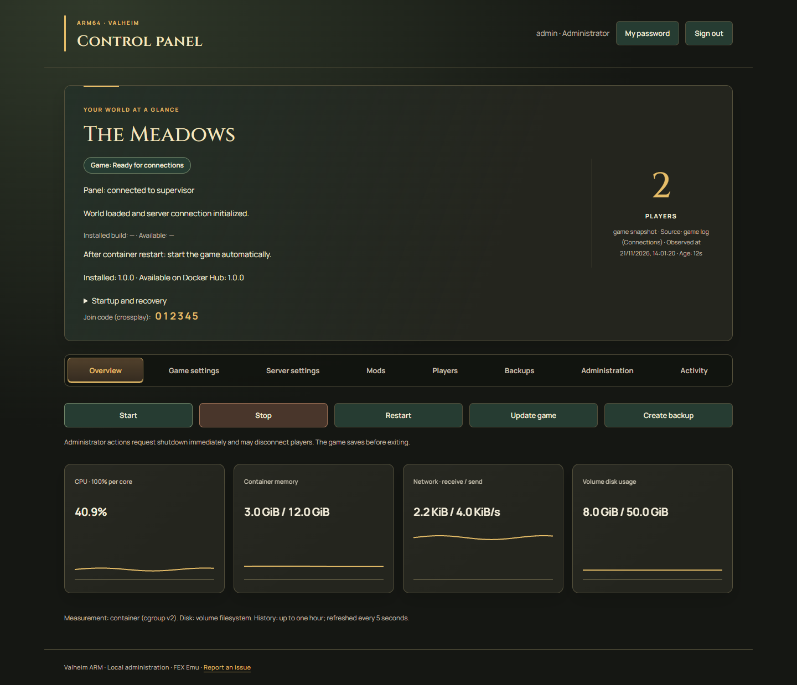

# Valheim Dedicated Server for ARM64

A Docker-based Valheim dedicated server for Linux ARM64 hosts. Install, play, and manage your world from an HTTPS web panel.

[Install](#install) · [Docker Hub](https://hub.docker.com/r/hfgalmeida/valheim-arm) · [Configuration reference](docs/REFERENCE.md) · [Report an issue](https://github.com/hfgalmeida/valheim-arm/issues/new/choose)

## Features

- **Ready-to-run ARM64 image** with FEX emulation; no local compilation.
- **Web administration** with mobile layout, administrator/operator accounts, audit history, and live metrics.
- **Automatic game updates, daily restarts, and backups**, with player-presence and completed-save checks.
- **Backup download and restoration**, optional OneDrive/Dropbox/Google Drive uploads, and overdue-backup alerts.
- **Crossplay, world modifiers, and player permission lists.**
- **Bundled optional BepInEx**, plugin uploads, recoverable deletion, and a configuration editor.

See the [server reference](docs/REFERENCE.md) for settings and commands.



*Panel preview with demonstration data. Metrics are illustrative, not performance benchmarks.*

## Install

Use **Ubuntu 24.04 or 26.04 LTS ARM64**, a Linux kernel >=5.15, 4 KiB memory pages, and an ARMv8.2-compatible CPU with atomics, CRC, and ASIMD. Recommended resources: **2 CPU cores, 12 GB RAM, and 30 GB free disk space**. You need sudo access and a reachable public IPv4 address.

Allow these inbound ports in your hosting provider/router and host firewall, while preserving SSH access:

| Purpose | Port | Source |
|---|---|---|
| Game | UDP 2456–2457 | `0.0.0.0/0` |
| Web panel | TCP 443 | `0.0.0.0/0` |

This panel rule allows access from any network, without registering your computer's IP. The login page is public; choose a strong administrator password. The installer adds these rules if UFW is already active. [Firewall details](docs/REFERENCE.md#network).

Run on the server:

```sh
curl -fL https://raw.githubusercontent.com/hfgalmeida/valheim-arm/main/install.sh -o install-valheim.sh
sudo bash install-valheim.sh
```

Enter the **server's public IP**, server/world names, game password, and a separate panel password. The installer downloads the public `hfgalmeida/valheim-arm:latest` image, prepares file access and the host updater, and starts the services in `./valheim-arm`.

## Play and open the panel

The first game download and world startup can take several minutes. Follow progress:

```sh
cd valheim-arm
sudo docker compose logs -f valheim
```

Press **Ctrl+C** to stop following logs; the server keeps running. Connect in Valheim to **YOUR_SERVER_IP:2456** with your game password.

Open **https://YOUR_SERVER_IP** and sign in as **admin** with the panel password. HTTPS is configured automatically. Trust the local certificate once on each browser computer using the [Windows/Linux certificate instructions](docs/REFERENCE.md#certificate).

Use the panel for game settings, accounts, plugins, backups, and image updates. Crossplay join codes appear after enabling crossplay and restarting the game.

## Automatic operation

The default schedule checks game updates, backs up, and restarts daily at **05:00**, using the configured time zone (**America/Sao_Paulo** by default). World saves run every 30 minutes. Backup retention keeps seven daily and four weekly representatives, plus the latest copy.

Automatic maintenance waits for confirmed zero players and a clean save. Administrator actions can disconnect players immediately. **Stop** keeps the game stopped across container/host restarts while leaving the panel available; use **Start** to resume.

Saves, editable settings, mods, and backups persist in `valheim-arm/data` when containers are removed. Keep independent off-host backups. Advanced commands, cloud setup, memory limits, and image rollback are in the [reference](docs/REFERENCE.md).

## Report a problem

Open a [GitHub issue](https://github.com/hfgalmeida/valheim-arm/issues/new/choose) with your image version, ARM hardware, reproduction steps, crossplay/mod settings, and a reviewed diagnostics report. In the installation directory:

```sh
sudo python3 scripts/collect-diagnostics.py --include-logs
```

The script creates `valheim-diagnostics-*.tar.gz` locally and never uploads it. It excludes saves, credential files, and plugin binaries; optional logs use best-effort redaction. **Extract and review `report.json` before attaching it.** [Report commands and download instructions](docs/REFERENCE.md#support).

## AI disclaimer

This project—including its code, interface, scripts, and documentation—was created entirely using AI, under human direction. It may contain defects or incorrect assumptions. Review it for your needs and keep independent backups before updates or recovery operations. This is an unofficial community project, not affiliated with the Valheim developers.

For architecture, development, and publishing, see the [maintainer guide](docs/MAINTAINER.md).

Project code is available under the [MIT license](LICENSE); third-party components retain their own licenses.

For existing pre-1.0 installations, [refresh the host updater before upgrading](docs/REFERENCE.md#image-updates).
