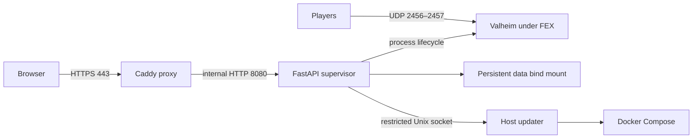

# Maintainer guide

Architecture, development, and release procedures for Valheim ARM. Deployment and server administration belong in [README](../README.md) and [REFERENCE](REFERENCE.md).

## Architecture

One `linux/arm64` image contains FEX, an x86 root filesystem, the Python supervisor, bundled BepInEx, and Caddy. Compose runs two separate containers using that same image:



| Component | Responsibility |
|---|---|
| `Dockerfile`, `docker/` | Native ARM64 FEX build, x86 rootfs/dependencies, bundled packages, Caddy |
| `app/runtime.py` | Serialized lifecycle, maintenance queue, scheduling, clean-save checks |
| `app/startup_watchdog.py`, `startup_diagnostics.py` | Startup phases, fatal-signal boundaries, bounded startup history, compatibility profile |
| `app/game_logs.py` | Bounded log-line draining without accepting oversized tails as messages |
| `app/players.py` | Conservative player snapshots and Steam A2S corroboration |
| `app/player_directory.py` | Persistent identity suggestions; never an online-player source |
| `app/backups.py`, `cloud.py` | Consistent archives, validation/restore, retention, rclone uploads |
| `app/alerts.py`, `backup_freshness.py` | Discord delivery, deduplication, backup-age monitoring |
| `app/auth.py`, `accounts.py`, `audit.py` | Sessions, roles, account lifecycle, private audit trail |
| `app/web.py`, `app/static/` | Authenticated API, server-sent events, responsive English interface |
| `app/file_access.py` | Selective persistent ACL access for the SSH user |
| `update-server.py`, `host-agent.py` | Controlled image updates and restricted host integration |
| `scripts/collect-diagnostics.py` | Local, bounded, redacted support reports |

The installer targets Ubuntu 24.04/26.04 ARM64 with 4 KiB pages. The image requires a Linux kernel >=5.15 and ARMv8.2 features including atomics/CRC/ASIMD. It does not install binfmt or compile FEX on the deployment host. The panel/API process is native Python; the game and SteamCMD use FEX.

## Lifecycle and maintenance

A single worker serializes destructive operations. Persisted run intent is independent of container restart policy: a manual stop keeps the game stopped after reboot, while the panel remains available.

Automatic maintenance and operator stop/restart requests require a ready game, a valid zero-player log snapshot for 120 seconds, applicable Steam A2S confirmation, and a final admission check. Steam queries alone cannot establish an empty server. Connection/reconnection messages invalidate the snapshot; expired or unknown presence never authorizes automatic maintenance. Administrator actions bypass admission/idle waiting but retain clean shutdown/save requirements.

SIGINT requests a graceful save and shutdown. A full archive/update requires both process exit and a completed-save marker (`World saved` or final chunked-save stage). Failed/uncertain saves retain the unclean marker and prevent subsequent backup/update work.

Fatal startup cleanup permits escalation only after an explicit fatal first-scene failure, before any world activity, with a known phase. Unknown/advanced phases block forced termination while the process is alive. Recovery resumes only after that same process exits, provided the run preference has not changed and the container is not shutting down; it never creates a backup or restores a world after a fatal exit. Identical repeated fatal-signal lines are summarized. Retries share a five-failure limit; stable sessions can reset the counter. `FEX_GAME_MODE=auto` selects compatibility for later attempts after eligible early crashes; explicit `standard`/`compatible` modes are available. The compatibility profile is a mitigation, not a guaranteed root-cause fix, and may reduce performance.

The compatibility environment is passed only to the game FEX process: full SMC checking, MonoHacks/multiblock/disk cache disabled, TSO retained. It stays in effect for that process. Startup history contains at most 20 metadata records, not raw logs or credentials.

## Persistent data and privacy

| Path | Contents / access |
|---|---|
| `data/saves` | World files and game permission lists; shared with the SSH user |
| `data/backups` | Complete archives and checksums; shared |
| `data/mods` | Plugin DLLs/configuration and recovery copies; shared |
| `data/config/overrides.json` | Editable panel overrides; selectively shared |
| `data/config/admin.json`, `panel-users.json` | Private Argon2 credentials |
| `data/config/audit.json` | Private bounded audit records |
| `data/config/maintenance*.json`, `run-intent.json` | Queue/history and desired run state |
| `data/config/startup-history.json` | Private bounded startup evidence |
| `data/config/alerts.json`, `alert-state.json`, `backup-age-state.json` | Private notification credentials/state and persistent grace periods |
| `data/cloud` | Private rclone connection, settings, upload receipts |
| `data/installs`, `current`, `home`, `cache` | Internal installations, symlink, emulation home/cache |
| `caddy_data`, `caddy_config` | Persistent proxy certificate authority and Caddy state |

The installer preserves existing `.env`, Compose, passwords, and saves. ACL synchronization grants access only to intended shared paths and repairs permissions after private atomic replacements. Never recursively expose all of `data` to the SSH user.

Backups validate manifests, hashes, extraction bounds, and relative paths. They exclude panel/cloud credentials and private notification/audit state. Saves are restored atomically with a protected pre-restore archive. Plugin DLLs and deleted-plugin copies are managed separately from world backups.

Cloud uploads verify local checksums, then transfer archive and checksum before recording success. Pending local copies are protected from retention. Cloud copies have no automatic deletion policy. Backup-age monitoring observes native archive creation timestamps with completion sidecars, not mutable mtime, and does not revalidate entire world archives on every poll.

## Authentication and API

Sessions use Argon2-backed credentials, HTTP-only cookies, same-origin checks, and CSRF tokens for mutations. Account changes invalidate sessions and pending requests. Temporary/reset passwords block normal access until changed. Operators are denied by default and receive a filtered state stream with only their own operations. Never rely on hidden buttons as authorization.

| Endpoint (`/api/v1` prefix) | Purpose |
|---|---|
| POST `/login`, `/logout`, `/password`; GET `/session` | Sign-in, sign-out, own-password change, session metadata |
| GET `/state`, `/events` | Current state/metrics/history; SSE updates with session revalidation |
| POST `/actions`; GET `/jobs/{id}` | Queue lifecycle/backup/update/restore work; role-filtered results |
| GET/PATCH `/config` | Effective settings, sources, validated overrides |
| GET/PUT `/users/{kind}` | Game administrator/banned/permitted lists and identity suggestions |
| PUT `/player-directory` | Administrator-confirmed ID/name/platform registration |
| GET/POST `/plugins` | Inspect/upload bounded managed DLLs |
| POST `/plugins/restore`, `/plugins/delete`, `/plugins/restore-deleted` | Revision-checked plugin recovery/deletion |
| GET `/mod-configs`, `/mod-config`; PUT `/mod-config`; POST `/mod-config/restore` | Bounded UTF-8 plugin settings editor |
| GET `/backups`, `/backups/{name}` | List/download complete archives |
| GET/PUT `/cloud`, `/alerts`; POST `/alerts/test` | Private cloud/notification settings and tests |
| GET `/image-version`, `/image-update`; POST `/image-update` | Public version lookup and restricted host update requests |
| GET/POST `/accounts`; PATCH `/accounts/{id}`; POST `/accounts/{id}/password` | Administrative account lifecycle |
| GET `/audit` | Administrator audit filters |

`/healthz` exposes only minimal supervisor/game health and desired-running state. Configuration and detailed diagnostics require authentication. HTTP 401/403/404/409/422 identify session, authorization, missing-resource, conflict, and validation errors; unavailable audit storage can reject mutations with 503.

Maintenance states are `queued`, `running`, `deferred`, `completed`, `failed`, and `cancelled`. `app/compatibility.py` normalizes pre-1.0 persisted operation states and audit field names on read, preserving user names/settings and historical text. Never enqueue terminal history records merely because a locale changed.

## Host updater

The agent is a separate root-owned systemd service with a restricted Unix socket mounted read-only into the game container. It checks the peer UID and accepts fixed status/update requests. Containers never receive the Docker socket or arbitrary host-command execution.

Installation uses a directory-derived identity, protected copies under `/usr/local/lib/valheim-arm/ID`, `/etc/valheim-arm/ID.json`, a generated Compose override, and `valheim-arm-updater-ID.service`. The installer enables the service automatically. It preserves a previous CLI copy when updating the managed version.

Image updates are serialized, honor persisted run intent, preflight before shutdown, back up before switching both containers, and verify stable readiness and HTTPS. Rollback preserves current persistent data. Interrupted or unverified recovery blocks new updates until resolved. For advanced host recovery:

```sh
sudo python3 update-server.py --directory /PATH/TO/INSTALLATION --rollback
sudo python3 update-server.py --directory /PATH/TO/INSTALLATION --reconcile
```

Reconciliation verifies the existing deployment without pulling, stopping, or switching images. It is for completing a stale record after the actual installation has already been recovered; it is not a substitute for repairing an unhealthy deployment.

## Development

Use Python 3.12 and Node.js. The application uses English text and state names. Dependency/game logs and user-provided names/configuration may use their own language. The local planning file is intentionally untracked and excluded from release archives.

```sh
python3 -m venv .venv
. .venv/bin/activate
pip install -r requirements-dev.txt
python -m pytest -q
node --check app/static/panel.js
bash -n install.sh
shellcheck install.sh
python -m black --check app tests scripts host-agent.py update-server.py
python -m ruff check app tests scripts host-agent.py update-server.py
```

Optional browser checks:

```sh
pip install -r requirements-browser.txt
python -m playwright install chromium
RUN_BROWSER_TESTS=1 python -m pytest tests/test_panel_browser.py -q
```

The `Checks` workflow runs source-level tests and static checks. Its native ARM image-build job is opt-in. CI does not download/start Valheim for gameplay tests. Keep synthetic tests isolated from production saves and avoid putting credentials into test output.

## Versioning and release

Change only `VERSION` for the image version, using `X.Y.Z` without `v`. Pushes to `main` trigger `Publish Docker Hub`, even when VERSION is unchanged. An existing exact image tag blocks publication; an unpublished version may receive multiple corrective commits.

Configure repository secret `DOCKERHUB_TOKEN` and variable (or existing secret) `DOCKERHUB_USERNAME`. Optional `DOCKERHUB_IMAGE` overrides the default lowercased GitHub owner/repository. Pulling the public image needs no Docker Hub login.

A native ARM64 runner builds FEX/rootfs and publishes the same image after supervisor tests, FEX preflight, and proxy configuration checks. FEX is resolved to a fixed release for each build. The image records FEX/package provenance in `/opt/build-info.json` and OCI labels. Tags include the semantic version, `latest`, and commit identification. Releases are serialized; authentication/network ambiguity blocks publication.

```sh
git add -A
git commit -m "Prepare release 1.0.0"
git push origin main
```

After the publication workflow succeeds and the exact image is available, create the matching GitHub release using the committed notes:

```sh
gh release create 1.0.0 --target COMMIT_SHA --title "Valheim ARM 1.0.0" --notes-file CHANGELOG.md
```

Do not republish an existing semantic image tag or claim hardware/plugin compatibility without evidence. Update the release version for fixes.

## Support reports

The collector uses read-only host/container queries, strict metadata allowlists, bounded command output/timeouts, and optional redacted recent logs. It never archives the data directory, raw environment/Compose output, credential files, saves, or binaries. Reports contain only generated JSON and instructions, are private by default, and are never uploaded automatically. Under sudo, the archive is assigned to the invoking SSH user for download. Review optional plugin logs before sharing publicly.

The project code is MIT licensed. Bundled components, game files, fonts, and libraries retain their own licenses; see their source/package notices and the license files shipped with the image/repository.
